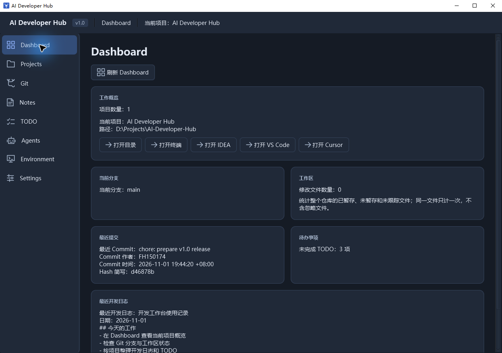
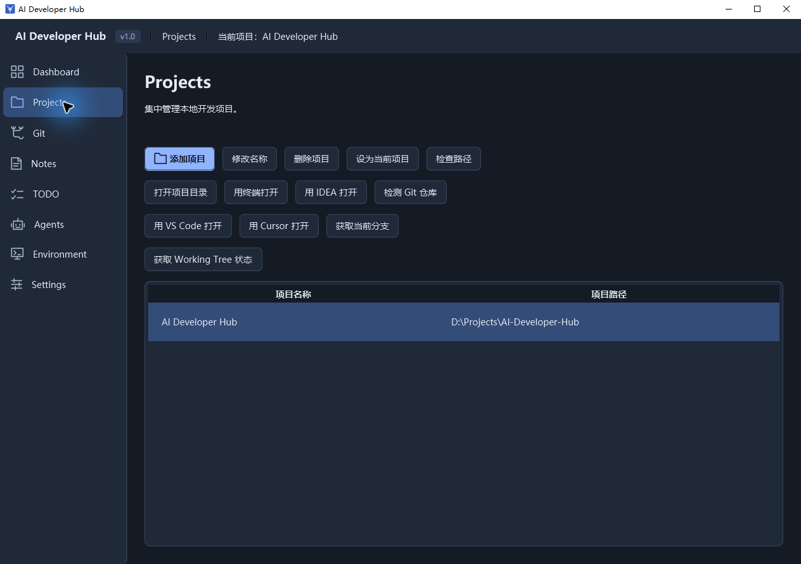
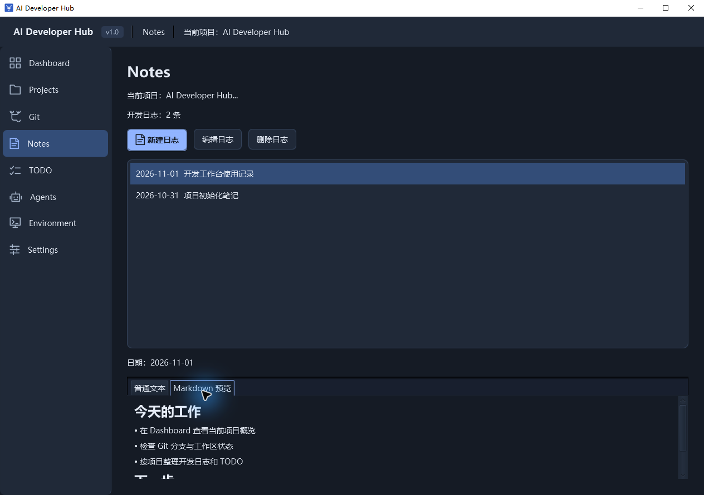
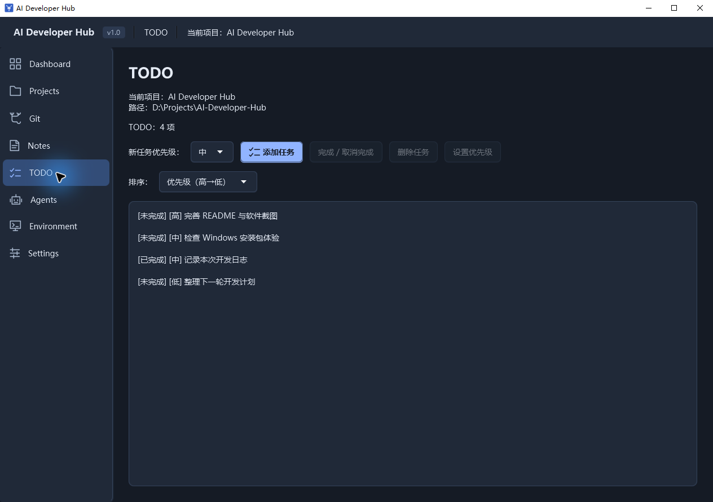
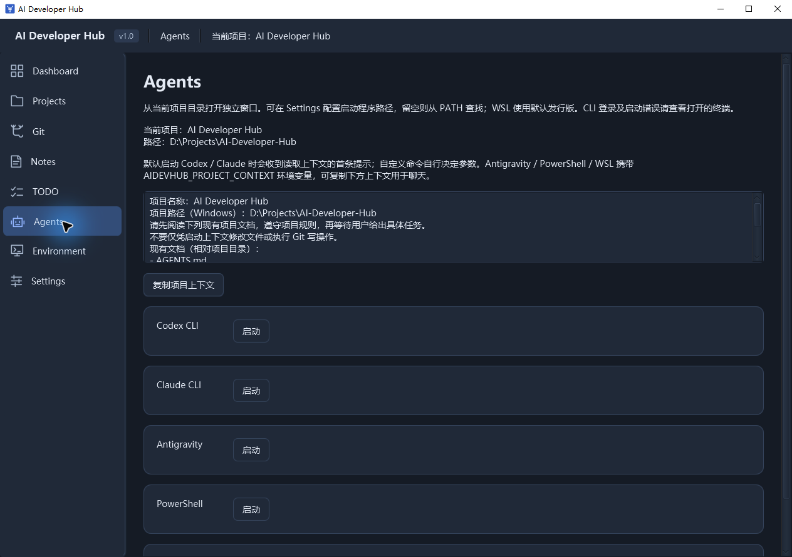

<p align="center">
  
</p>

<h1 align="center">AI Developer Hub</h1>

<p align="center">面向个人开发者的 Windows 桌面开发工作台</p>

<p align="center">
  <a href="https://github.com/FH150174/AI-Developer-Hub/releases/tag/v1.0"></a>
  
  
  
  
</p>

<p align="center">
  <a href="#下载使用">下载使用</a> ·
  <a href="#主要功能">主要功能</a> ·
  <a href="#软件截图">软件截图</a> ·
  <a href="#从源码运行">从源码运行</a> ·
  <a href="#项目文档">项目文档</a>
</p>

把本地项目、Git 状态、开发日志、TODO 和 AI Agent 入口放在同一个窗口里。打开工作台，选好当前项目，就能查看开发进度、记录下一步工作，并快速进入 IDE、终端或 Agent。



## 下载使用

当前正式版本：**v1.0**（应用版本 `1.0.0`）。

**[下载 Windows 安装包](https://github.com/FH150174/AI-Developer-Hub/releases/download/v1.0/AI.Developer.Hub-1.0.0.exe)** · [版本说明与校验文件](https://github.com/FH150174/AI-Developer-Hub/releases/tag/v1.0)

1. 下载并运行 `AI.Developer.Hub-1.0.0.exe`，按向导安装。
2. 启动应用，在 **Projects** 中添加已有的本地项目目录。
3. 选中项目，点击 **设为当前项目**。
4. 在 **Dashboard** 查看概览，在 **Notes / TODO** 记录工作，在 **Settings** 配置常用工具。

安装包附带 Java 21 运行时和 JavaFX，使用安装版无需额外安装 Java。Git、IDE、Agent CLI 等外部工具需要自行安装；Agent 的登录也由相应工具完成。

如需校验下载文件，可将下面的 SHA-256 结果与 Release 中的 `SHA256SUMS.txt` 对照：

```powershell
Get-FileHash .\AI.Developer.Hub-1.0.0.exe -Algorithm SHA256
```

## 主要功能

| 页面 | 可以做什么 |
| --- | --- |
| **Dashboard** | 汇总项目数量、当前项目、Git 分支、变更文件数、最近提交、未完成 TODO 和最近开发日志；快速打开目录、终端或 IDE |
| **Projects** | 添加、改名、移除本地项目，检查路径，切换当前项目；使用 IntelliJ IDEA、VS Code、Cursor 或终端打开项目 |
| **Git** | 检测 Git 安装状态，查看当前分支、最近提交和工作区变更明细，区分暂存区、工作区与未跟踪文件 |
| **Notes** | 按项目新建、编辑、删除开发日志，记录日期，查看普通文本或基础 Markdown 预览 |
| **TODO** | 按项目管理待办，切换完成状态，设置高 / 中 / 低优先级并排序 |
| **Agents** | 从当前项目目录启动 Codex CLI、Claude CLI、Antigravity、PowerShell 或 WSL，预览并复制项目上下文 |
| **Environment** | 检测 PATH 中的 Java、Maven、Git、Node.js、Python 版本，检查 IDE 路径、WSL 状态和 PATH |
| **Settings** | 配置 IDE 与 Agent 启动路径、默认项目目录、终端、深浅色主题和启动页面 |

项目列表、设置、日志与 TODO 保存在本地。Git 页面提供状态查询；提交、推送、合并等操作由开发者在自己的工具中执行。Agents 页面负责启动外部工具和准备上下文，不内置模型 API 聊天。

## 软件截图

以下图片来自 **v1.0 Windows 应用的真实运行界面**，展示深色主题；日志和 TODO 使用隔离的演示数据。Dashboard 见上方，其余页面可展开查看。

<details open>
<summary><strong>Projects · 本地项目与工具入口</strong></summary>

添加已有项目，设为当前项目，再从同一处进入目录、终端和编辑器。



</details>

<details>
<summary><strong>Notes · 开发日志与 Markdown 预览</strong></summary>

将开发记录留在项目旁，按日期回看进展，使用基础 Markdown 整理内容。



</details>

<details>
<summary><strong>TODO · 优先级与完成状态</strong></summary>

让下一步工作有迹可循，按优先级安排任务并跟踪完成情况。



</details>

<details>
<summary><strong>Agents · 带着项目上下文开始工作</strong></summary>

预览项目上下文，从当前项目目录启动已配置的 Agent 或终端工具。



</details>

## 从源码运行

### 环境准备

- Windows，使用 **JDK 21**；`JAVA_HOME` 指向完整 JDK。
- Maven 可在终端中调用。
- Git 已安装并加入 PATH，用于 Git 功能与相关集成测试。
- IntelliJ IDEA、VS Code、Cursor 和 Agent CLI 按需安装。

### 启动

```powershell
git clone https://github.com/FH150174/AI-Developer-Hub.git
cd AI-Developer-Hub
mvn javafx:run
```

Maven 会解析项目已声明的 JavaFX 依赖，无需手工配置 JavaFX SDK。也可以在 IntelliJ IDEA 中打开 `pom.xml`，将项目 SDK 设置为 JDK 21，通过 Maven 的 `javafx:run` 启动。

从源码运行时，界面显示“开发版”；打包应用显示对应的版本号。

### 首次配置

- 在 **Settings** 中设置 IDEA、VS Code、Cursor 的启动程序路径。
- Agent 启动程序路径可在 **Settings** 中配置；留空时从 PATH 查找。WSL 使用默认发行版。
- 根据本机环境选择 PowerShell 7、Windows PowerShell 或 CMD。
- 如果刚安装工具或修改 PATH，请重启应用，让它读取新的环境变量。

## 本地数据

默认数据目录为 `%APPDATA%\AI-Developer-Hub\`，与程序安装目录分离：

```text
AI-Developer-Hub/
├── settings.xml        # 应用设置
├── ide-paths.xml       # IDE 启动路径
├── agent-paths.xml     # Agent 启动配置
├── projects.xml        # 本地项目列表
├── notes/              # 按项目保存的开发日志
└── todos/              # 按项目保存的 TODO
```

数据使用 JDK Properties XML。需要备份时，先退出应用，再复制整个数据目录。

升级自早期版本时，如果新数据目录尚不存在，应用会复制旧 `${user.home}/.aidevhub/` 中的受支持数据，并保留旧目录；新目录已存在时以新目录为准，不进行合并。详细规则见 [本地数据目录说明](docs/ARCHITECTURE.md#task-053-本地数据目录)。

## 测试与打包

运行全部测试：

```powershell
mvn test
```

测试使用 JUnit 5，覆盖项目管理、Git 查询、配置与存储、日志、TODO、外部进程和 JavaFX UI 冒烟场景。部分测试需要 Windows 与可用的 Git；分组运行方式和环境要求见 [测试体系](docs/TESTING.md)。

生成 Windows 应用目录（附带运行时，无需 WiX）：

```powershell
powershell.exe -NoProfile -ExecutionPolicy Bypass -File .\scripts\package-windows.ps1 -Type app-image
```

生成 `.exe` 安装包（另需 WiX 3.x）：

```powershell
powershell.exe -NoProfile -ExecutionPolicy Bypass -File .\scripts\package-windows.ps1
```

产物输出到 `target/dist/` 下的独立目录。分发应用目录时，需要携带整个应用文件夹。工具路径参数、启动验证以及安装、升级、卸载验收说明见 [Windows 打包指南](docs/PACKAGING.md)。

## 技术与代码组织

**Java 21 · JavaFX 21 · Maven · JUnit 5 · Git CLI · jpackage**

按功能组织代码，在各功能内部划分 UI、服务、领域与基础设施职责。基础包为 `com.fhaicl.aidevhub`：

```text
src/main/java/com/fhaicl/aidevhub/
├── dashboard/      # 工作概览
├── project/        # 本地项目管理与工具打开
├── git/            # Git 状态查询
├── notes/          # 开发日志与 Markdown
├── todo/           # 项目待办
├── agent/          # Agent 启动与项目上下文
├── environment/    # 开发环境检测
├── settings/       # 配置与设置界面
├── storage/        # 数据目录与迁移
├── process/        # 进程输出支持
├── navigation/     # 页面导航
└── ui/             # 共享 UI 组件与应用标识
```

## 项目文档

| 文档 | 内容 |
| --- | --- |
| [需求说明](docs/REQUIREMENTS.md) | 产品定位、需求方向和约束 |
| [架构说明](docs/ARCHITECTURE.md) | 模块组织、分层与数据目录规则 |
| [开发流程](docs/DEVELOPMENT.md) | Task 范围、开发、验证与 Review |
| [测试体系](docs/TESTING.md) | 测试职责、分组命令与环境要求 |
| [Windows 打包](docs/PACKAGING.md) | jpackage、安装包、运行时与验收 |
| [路线图](docs/ROADMAP.md) | 项目迭代方向与里程碑规划 |
| [Agent 协作规则](AGENTS.md) | AI Agent 的职责、修改范围与 Git 约束 |

## 关于这个项目

AI Developer Hub 从个人日常开发需求出发，也用于练习 Java 桌面开发、Git / GitHub、测试、Code Review、架构设计和多 Agent 协作。

项目遵循 **小任务 → 小修改 → 测试 → Review → Commit → 下一任务** 的节奏。参与开发前请先阅读 [AGENTS.md](AGENTS.md)，将改动限定在明确的 Task 范围内。

欢迎通过 [Issues](https://github.com/FH150174/AI-Developer-Hub/issues) 反馈问题和使用建议。报告问题时，请附上应用版本、Windows 环境、复现步骤与相关截图。
